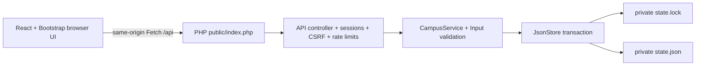

# CampusFest architecture

## Request flow



Development defaults to Vite on `127.0.0.1:5173` and PHP on `127.0.0.1:8000`. When another application occupies port 8000, PHP can use a free port such as 8765 and the Vite terminal can set `CAMPUSFEST_API_TARGET=http://127.0.0.1:8765`. The browser always calls relative `/api` URLs. Vite proxies those requests and their cookies to PHP, avoiding separate-origin authentication configuration. Node is a build/development tool; PHP is the application backend.

`npm run build` in `frontend` produces Vite's optimized output and copies it into `backend/public` without deleting PHP entry files. The PHP development router permits known static asset extensions inside that directory, passes API paths to PHP, and serves the SPA shell for application routes. API paths are resolved before SPA fallback, so unknown API paths return JSON errors. Refreshing a deep link loads the app correctly. The optional Apache virtual host uses the same public-only boundary.

## Code organization

| Area | Responsibility |
| --- | --- |
| `frontend/src/pages/` | Public discovery/registration/pass screens and organizer workflows |
| `frontend/src/components/` | Shared cards, fields, dialog, status, chart and roster UI |
| `frontend/src/hooks/` | Session state and asynchronous resource loading |
| `frontend/src/services/api.js` | Centralized Fetch, JSON errors, cookies and CSRF |
| `frontend/src/utils/` | Validation and Asia/Kolkata presentation |
| `frontend/src/styles/` | Custom editorial layout, responsive and print styles |
| `backend/public/` | Only web-accessible directory; API entry, router, built frontend |
| `backend/src/controllers/ApiController.php` | HTTP methods, paths, payload parsing and response status |
| `backend/src/middleware/` | Session authentication, CSRF, bounded IP throttling |
| `backend/src/services/CampusService.php` | Capacity, FIFO, cancellation, lifecycle, ownership, attendance and export rules |
| `backend/src/validators/Input.php` | Typed input, lengths, schedules, roster/member validation and normalization |
| `backend/src/storage/JsonStore.php` | Locked reads/transactions and complete state replacement |
| `backend/scripts/` | Explicit initialization/demo setup and organizer maintenance |
| `backend/tests/` | Isolated domain, persistence, API and concurrent-process checks |

## Canonical private state

```json
{
  "schemaVersion": 1,
  "nextRegistrationSequence": 1,
  "organizers": [],
  "events": [],
  "registrations": [],
  "auditLog": [],
  "rateLimits": {}
}
```

`rateLimits` is added when throttled requests occur. Demo initialization also marks `demo: true` and records `seededAt`; reset refuses state without that demo marker. Organizers have IDs and `passwordHash` values (demo IDs are deterministic; real organizer IDs are random). Events own organizer IDs, validated schedules and lifecycle fields. Registrations include event/pass IDs, a management-code hash, status, monotonic sequence, members, leader reference, creation/promotion/cancellation metadata and per-member attendance. The plaintext management code is not stored. Derived counts, queue positions, availability and phase are calculated from current state and time. Audit history retains the most recent 1,000 entries.

The canonical file holds all entities that must change atomically. It is not split into independently writable events and registrations files. PHP session files are private and separate; session cookies hold only a session identifier. Runtime files, sessions, lock files, temporary files and logs are excluded from version control.

## Transaction protocol

1. Open a stable, separate `state.lock` file. Readers acquire `LOCK_SH`; mutations acquire `LOCK_EX` **before reading**.
2. Read and decode `state.json` with explicit JSON/schema checks. Missing initialized state and corrupt data fail; they never become empty arrays.
3. While holding the exclusive lock, validate current data and server time, assign sequence numbers, enforce ownership/duplicates/capacity, and perform every related state change. Cancellation and promotion are one transaction.
4. Encode the complete next state. Write a uniquely named temporary file in the same directory, check every write, flush it, and call `fsync` when available.
5. Close the temporary file and rename it over the canonical state. Do not unlink the old canonical file first. Bounded retries accommodate transient Windows file-handle interference while retaining the exclusive lock. If replacement still fails, report failure and retain the previous valid state.
6. Clean up the temporary file and release the stable lock in `finally`.

The lock file is not replaced. Locking only the final write or locking the replaced state inode would allow lost updates; all application and maintenance access goes through `JsonStore`. The injectable clock in the domain layer and a pre-replacement test seam make boundaries and interrupted commits testable without changing real demo data.

Initialization is explicit. HTTP startup never seeds or resets data. Storage mutation failure never produces a registration success response. If persistence succeeds but the client loses the response, an organizer locates the entry and explicitly rotates its code after verification; the client must not silently replay the POST.

## Sessions and privacy

Organizer passwords use PHP `password_hash` / `password_verify`. Login regenerates the session ID and CSRF token. Session cookies use HttpOnly and SameSite=Lax; Secure is set when PHP receives HTTPS. The default idle timeout is 1,800 seconds. A password reset changes a credential fingerprint, invalidating previous organizer sessions. Logout destroys the session and expires its cookie.

Anonymous sessions only support CSRF; they are not student accounts. Every mutation and private pass lookup requires a session CSRF token. A student pass lookup requires both pass ID and the private code in a JSON body. Hash comparison uses a constant-time comparison. Secrets are excluded from URLs, localStorage, public responses, CSV, printouts and diagnostics.

HTTP JSON requests are limited to 64 KiB. Login, registration, and private pass requests use bounded buckets based on server-provided `REMOTE_ADDR`, ignoring arbitrary forwarding headers. Limits are 15 login, 30 registration, and 60 pass requests per ten minutes per address/action. At most 2,000 live buckets are retained; a full bucket store fails closed. Shared campus networks can therefore share throttling limits.

Ownership is checked in the service for each organizer event, roster, mutation and export. User text is rendered as text in React; there is no arbitrary HTML insertion or unrestricted upload/backend URL fetch. API responses are `no-store`; production exception output is disabled and diagnostic messages exclude request payloads.

## Supported deployment boundary and limitations

This is a single-instance, local-filesystem course application. Every operation reads the whole JSON state; writes serialize under one lock. It is suitable for a modest local demonstration, not a distributed/high-throughput database. Audit and throttling data are bounded; events and registrations need deliberate retention and maintenance as they grow.

The intended filesystem is a local Windows NTFS or local macOS/Linux filesystem with working advisory `flock` and same-directory rename replacement. Windows antivirus, sync software, filesystem permissions or a second program holding a file handle can make replacement fail; the old state is retained and the API reports failure. Do not put active runtime storage on network shares, NFS/SMB, cloud-synchronized folders, or separate hosts. If the checkout is in OneDrive, choose a nonsynchronized private `CAMPUSFEST_STORAGE` directory. No power-loss durability guarantee is made for filesystems or operating systems that do not persist directory renames as expected.

Only `backend/public` may be exposed. `JsonStore` rejects a storage directory that resolves inside that public directory. A static-only host cannot execute PHP, handle sessions, or commit JSON. HTTPS/reverse-proxy operations, backups, retention policies, verified institutional identity, notification delivery and multi-server deployment are outside this local demo's scope. Do not trust `X-Forwarded-*` automatically; configure HTTPS correctly at the PHP web server if hosting later.
