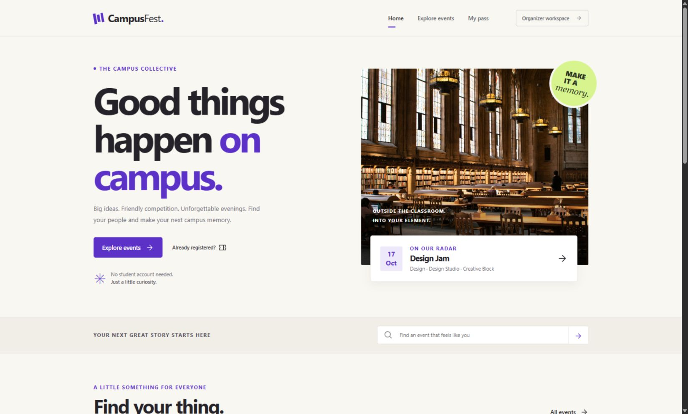
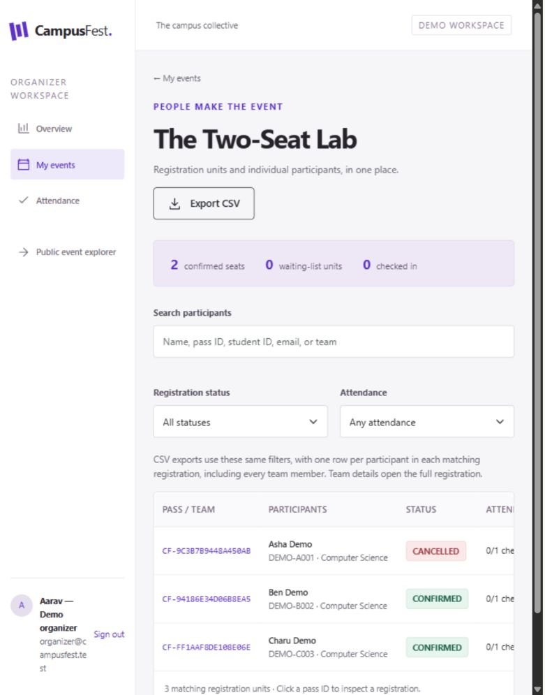

# Verification record

Verified on Windows on 12–13 October 2026 with PHP 8.4.26, Node.js 22.17.1 and npm 11.12.0. PHP used the ignored local runtime `.tools/php/php.exe`; normal installations can use `php` on PATH. Automated tests use isolated temporary storage. Browser testing used separate `.runtime/browser-demo` storage and PHP on port 8765.

| Check | Actual command / method | Observed outcome |
| --- | --- | --- |
| PHP syntax | `Get-ChildItem backend -Filter *.php -Recurse` with `& .tools/php/php.exe -l $_.FullName` for each file | PASS: all 21 PHP files |
| Domain/storage/CLI rules | `& .tools/php/php.exe backend/tests/domain.php` | PASS: 14 scenarios, 138 assertions, 0 failures |
| Concurrent registration/cancellation | `& .tools/php/php.exe backend/tests/concurrency.php` | PASS: 28 separate PHP processes, 15 assertions |
| Frontend tests | `npm --prefix frontend test` | PASS: 4 files, 25 tests |
| Frontend lint | `npm --prefix frontend run lint` | PASS |
| Production build/copy | `npm --prefix frontend run build` | PASS; generated app and images copied to PHP public root |
| HTTP/session/privacy integration | `$env:PHP_BINARY=(Resolve-Path .tools/php/php.exe).Path; node backend/tests/http.mjs` after production build | PASS: 46 checks |
| Dependency audit | `npm --prefix frontend audit` | PASS: zero known vulnerabilities at verification time |
| Vite development proxy | Set `CAMPUSFEST_API_TARGET=http://127.0.0.1:8765`, run `npm --prefix frontend run dev -- --host 127.0.0.1`, request through port 5173 | PASS: session API, HttpOnly cookie, CSRF token, SPA deep link |
| Live UI workflow | Browser steps below using the real PHP API | PASS: registration, private retrieval/cancellation/promotion, organizer roster, attendance, team registration, restart persistence |
| Actual demo CSV | Authenticated HTTP download of RoboRally export from browser-demo storage | PASS: header + 3 participant rows, attendance timestamp, no code/password fields. Browser download automation stalled; native browser download completion remains unverified |
| Responsive review | Home, details, registration, My Pass, dashboard, attendance at 360, 768 and desktop 1440px; additional homepage capture at 1663px | PASS: screenshots and DOM inspected, no horizontal page overflow in checked layouts; local images loaded |
| Browser console | Error/warning capture during final walkthrough | No errors or warnings reported |
| Keyboard interactions | Mobile navigation and Escape dismissal of attendance dialog | PASS; dialog initially focuses its close control |
| Print output | Print CSS inspection and PassCard component tests | Secret outside printable pass; confirmed/waitlist wording tested. Native print-preview/PDF rendering not run |
| macOS/Linux / Apache | Documented alternative setup | Not run in this Windows environment |

## Automated coverage

The domain suite covers solo/team validation, duplicate identities, capacity units, FIFO order and promotion, repeat cancellation, waitlisted cancellation, capacity edits, fresh priority on re-registration, deadlines/lifecycle/start boundaries, code verification/rotation, ownership, individual attendance and undo, corrupt JSON, failed commits, and explicit safe setup/seed/organizer CLI behavior.

The concurrency suite uses independent PHP processes sharing one isolated state file: 12 contenders for the final seat yield 1 confirmed and 11 waitlisted; 8 duplicate attempts yield 1 stored entry and 7 rejections; 8 repeated cancellations yield exactly 1 promotion. This is not a test against the single-worker development server.

The HTTP suite covers sessions, cookie attributes, login/logout/expiry, CSRF, request shape/size, ownership across reads/writes/export/attendance/rotation, queue behavior, private access, team attendance and repeated check-in/undo, CSV escaping/formula neutralization, bounded throttling, secret hashing, direct-storage denial, safe GET behavior, unknown API routes, SPA deep links, and an actual PHP process restart.

Frontend tests exercise registration validation and submission, numeric year conversion, retained inputs after conflict, no automatic retry or false success, URL filters/IST presentation, waitlist pass wording, secret separation, and usable confirmation cancellation.

## Observed browser demonstration

1. Opened empty **The Two-Seat Lab** with two available seats.
2. Submitted Asha Demo, Ben Demo and Charu Demo through registration, review and confirmation. Asha and Ben received confirmed passes; Charu received waitlist position 1 and the explicit non-admission warning.
3. Retrieved Asha with her pass ID and management code, confirmed cancellation, and saw cancelled status.
4. Retrieved Charu using her original access details and manually refreshed: her status was confirmed automatically.
5. Signed in as `organizer@campusfest.test`. The roster showed Asha cancelled, Ben/Charu confirmed, 2 confirmed seats and 0 waitlisted units.
6. Opened seeded ongoing RoboRally, found `CF-DEMO-0008` (Arjun Nair), checked him in, then selected **Check in again (safe)**. Count remained 1 and timestamp remained **13 Oct 2026, 12:08 am IST**.
7. Exported that actual roster through the authenticated API after the browser download handler stalled. CSV contains one row each for Arjun, Leela and Rohan, with Arjun's single timestamp `2026-10-12T18:38:36Z`.
8. Restarted PHP with the same storage and no seed command. The browser roster still showed Asha cancelled and Ben/Charu confirmed; RoboRally still showed 1 checked-in participant and the same timestamp. Private-pass persistence after restart is additionally covered by the HTTP suite.
9. Submitted **Pixel Pioneers Demo**, with Devika Demo and Eshan Demo, through the live team form. It created one confirmed team with two members, raising Design Jam from 1 to 2 confirmed teams and from 3 to 5 participants.

Management codes are absent from saved screenshots and documentation. Time elapsed between initial demo and restart meant RoboRally had ended by final inspection; its attendance remained visible. New seed dates are relative to the time the command is run.

## Fixes and environment limits

Testing exposed a transient Windows file replacement failure. Bounded retries of the same atomic rename now occur under the stable exclusive lock without deleting the previous canonical file. Domain, concurrency and HTTP suites passed after this fix. Injected commit interruption and a real failed replacement preserve previous valid data.

Browser review led to fixes for the desktop navigation toggle, registration form width, hero caption overlap, small text, team-year conversion, and confirmation/attendance lifecycle controls. Final independent backend review found no material blockers. Dependency updates resolved the initial audit findings.

The agent environment required permission for localhost networking and an unrestricted Vitest run after a sandbox temporary-file rename failure. Those permitted runs passed. Port 8000 belonged to another application, so QA used 8765 without stopping that application. Only this task's preview servers were stopped at teardown.

JSON storage targets one PHP application instance on a local filesystem. Active data should live outside the OneDrive checkout through `CAMPUSFEST_STORAGE`, as in the README. Native print preview, browser-native download completion, other operating systems and Apache remain unverified. No deployment was performed.
